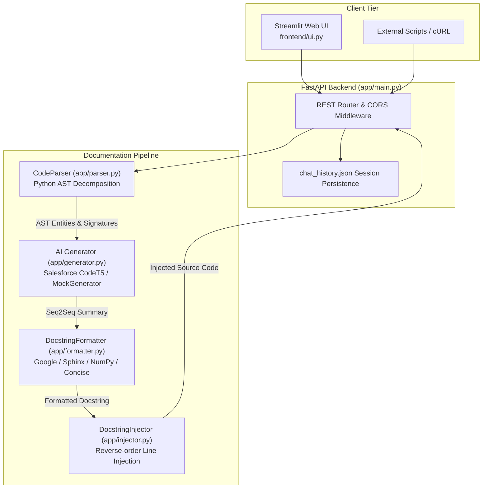

# AI-Assisted Technical Documentation Generator

[](https://www.python.org/)
[](https://fastapi.tiangolo.com/)
[](https://streamlit.io/)
[](https://huggingface.co/Salesforce/codet5-base-multi-sum)
[]()
[](LICENSE)

An intelligent Python documentation and docstring generation system that combines Python's native Abstract Syntax Tree (**AST**) analysis with the **Salesforce CodeT5** sequence-to-sequence transformer model. Automatically parses code structures, produces standard docstrings (Google, Sphinx, NumPy, or Concise), and injects them back into source code files.

---

## 1. Project Overview

Drafting consistent, accurate technical documentation across large software projects is repetitive and time-consuming. This system automates the documentation workflow through:

1. **AST Structural Decomposition**: Inspects Python code using the `ast` module to identify functions, classes, and methods, extracting argument types, default values, return annotations, decorators, and explicitly raised exceptions.
2. **Transformer Code Summarization**: Employs `Salesforce/codet5-base-multi-sum` (~890 MB) locally via Hugging Face Transformers and PyTorch to generate natural language descriptions of what each code entity does.
3. **Multi-Style Formatting**: Converts raw AI summaries into industry-standard docstrings (**Google Style**, **Sphinx / reST**, **NumPy**, or **Concise Summary**).
4. **Source Code Injection**: Injects newly formatted docstrings directly into the original Python source code file beneath each `def` or `class` header while maintaining precise indentation.
5. **Dual Interface**: Offers an asynchronous **FastAPI** REST backend and an interactive **Streamlit** dark-themed chat user interface.




---

## 2. Key Features

- **Intelligent AST Parsing**:
  - Extracts top-level functions, classes, and class methods.
  - Automatically isolates parameters, type hints, default values, `*args`, and `**kwargs`.
  - Detects explicit `raise` exception types without descending into nested scopes.
  - Catches syntax errors with line numbers, column offsets, and error descriptions.
- **Multiple Docstring Formats**:
  - **Google Style** (`Args:`, `Returns:`, `Raises:`)
  - **Sphinx Style** (`:param:`, `:type:`, `:return:`, `:raises:`)
  - **NumPy Style** (`Parameters`, `Returns`, `Raises`)
  - **Concise / Detailed Summary** (single-block explanations)
- **Docstring Injection Engine**:
  - Automatically updates source code by inserting generated docstrings with accurate indentation.
  - Replaces existing docstrings cleanly without duplicating blocks or breaking syntax.
- **Local AI Inference**:
  - Powered by `Salesforce/codet5-base-multi-sum`.
  - Runs 100% locally on CPU or CUDA GPU without requiring external paid API keys (OpenAI, Gemini, etc.).
- **Pluggable Architecture**:
  - Production `CodeT5Generator` for real model inference.
  - Rule-based `MockGenerator` for rapid offline development, CI/CD pipelines, and automated testing (`DOCGEN_MODE=mock`).
- **Modern REST API & Interactive UI**:
  - Asynchronous FastAPI server with Swagger documentation at `/docs` and health diagnostics at `/health`.
  - Streamlit web interface with real history restoration, docstring style selector, file upload, and one-click download buttons (`.py` and `.md`).

---

## 3. Tech Stack

| Component | Technology | Description |
| :--- | :--- | :--- |
| **Backend Framework** | FastAPI | Asynchronous REST API framework with OpenAPI documentation |
| **Web Server** | Uvicorn | High-performance ASGI server |
| **Frontend UI** | Streamlit | Interactive web chat interface with custom dark theme |
| **AST Parser** | Python `ast` | Native Abstract Syntax Tree analysis and source segmentation |
| **AI / Machine Learning** | Hugging Face Transformers & PyTorch | Local execution of `Salesforce/codet5-base-multi-sum` |
| **Docstring Formatting** | Python | Standard formatting engine (Google, Sphinx, NumPy) |
| **Data Validation** | Pydantic v2 | Typed schemas and request payload validation |
| **Testing** | Pytest & HTTPX | Automated unit and integration test suite |

---

## 4. Directory Structure

```text
AI-Assisted-Technical-Documentation-Generator/
├── app/
│   ├── __init__.py
│   ├── formatter.py       # Multi-style docstring formatter (Google, Sphinx, NumPy)
│   ├── generator.py       # Pluggable generator architecture (CodeT5 & MockGenerator)
│   ├── injector.py        # Source code docstring injection engine
│   ├── main.py            # FastAPI REST routes, CORS, history, and health endpoints
│   ├── models.py          # Pydantic schemas (CodeRequest, DocStringResponse, etc.)
│   └── parser.py          # AST extraction logic (CodeParser)
├── frontend/
│   └── ui.py              # Streamlit dark-mode interactive chat interface
├── tests/
│   ├── __init__.py
│   ├── test_api_client.py # FastAPI integration tests using TestClient
│   ├── test_formatter.py  # Unit tests for docstring formatting
│   ├── test_injector.py   # Unit tests for source code injection
│   └── test_parser.py     # Unit tests for AST parsing and error handling
├── results/               # Directory for test summary logs
│   └── .gitkeep
├── .gitignore             # Git ignore definitions
├── LICENSE                # MIT License
├── README.md              # Project documentation
├── requirements.txt       # Python dependencies
├── run_complex_test.py    # Integration test for complex code structures
└── test_api.py            # Quick API verification test script
```

---

## 5. Installation & Setup

### Prerequisites
- Python 3.9, 3.10, or 3.11 installed.
- (Optional) NVIDIA GPU with CUDA for accelerated transformer inference.

### 1. Clone the Repository
```bash
git clone https://github.com/usha1101/AI-Assisted-Technical-Documentation-Generator.git
cd AI-Assisted-Technical-Documentation-Generator
```

### 2. Set Up Virtual Environment
- **Windows (PowerShell):**
  ```powershell
  python -m venv --system-site-packages .venv
  .\.venv\Scripts\activate
  ```
- **macOS / Linux:**
  ```bash
  python3 -m venv .venv
  source .venv/bin/activate
  ```

### 3. Install Dependencies
```bash
pip install -r requirements.txt
```

---

## 6. Running the Application

### Option A: Start the FastAPI Backend
```bash
# Production mode (uses CodeT5 local transformer inference)
python -m app.main
```
- Server URL: **http://127.0.0.1:8000**
- Interactive Swagger UI: **http://127.0.0.1:8000/docs**
- Health Check: **http://127.0.0.1:8000/health**
- *Note: On first startup, the CodeT5 model weights (~890 MB) are automatically downloaded from Hugging Face Hub.*

> [!TIP]
> **Offline / Rapid Development Mode (`DOCGEN_MODE=mock`)**:
> To test or develop locally without downloading the 890MB model weights:
> - **Windows PowerShell**: `$env:DOCGEN_MODE="mock"; python -m app.main`
> - **Linux / macOS**: `DOCGEN_MODE=mock python -m app.main`

### Option B: Start the Streamlit Frontend
In a separate terminal (with `.venv` activated):
```bash
streamlit run frontend/ui.py
```
- Access in browser: **http://localhost:8501**
- **Default Sign-in Credentials**:
  - **Username**: `user`
  - **Password**: `1234`

---

## 7. API Reference

| Endpoint | Method | Description |
| :--- | :--- | :--- |
| `/health` | `GET` | Returns generator status, compute device (`cpu`/`cuda`), and timestamp |
| `/generate-docs` | `POST` | Parses code and returns generated docstrings with entity metadata |
| `/generate-documented-file` | `POST` | Injects generated docstrings directly into the source code |
| `/export-markdown` | `POST` | Returns formatted GitHub-flavored Markdown documentation |
| `/history/{session_id}` | `GET` | Retrieves saved generation history for a specific session |

#### cURL Examples

**1. Generate Docstrings (`POST /generate-docs`):**
```bash
curl -X POST "http://127.0.0.1:8000/generate-docs" \
     -H "Content-Type: application/json" \
     -d '{
       "source_code": "def calculate_discount(price: float, discount: float = 0.1) -> float:\n    return price * (1.0 - discount)",
       "style": "google",
       "complexity": "concise"
     }'
```

**2. Generate Injected Python File (`POST /generate-documented-file`):**
```bash
curl -X POST "http://127.0.0.1:8000/generate-documented-file" \
     -H "Content-Type: application/json" \
     -d '{
       "source_code": "def add(a: int, b: int) -> int:\n    return a + b",
       "style": "google"
     }'
```

**3. Export as Markdown Documentation (`POST /export-markdown`):**
```bash
curl -X POST "http://127.0.0.1:8000/export-markdown" \
     -H "Content-Type: application/json" \
     -d '{
       "source_code": "class Calculator:\n    def compute(self, x: float) -> float:\n        return x * 2",
       "style": "numpy"
     }'
```

---

## 8. Running Automated Tests

Run the complete test suite with `pytest`:
```bash
pytest -v
```

All 22 unit and integration tests validate:
- Top-level function, class, and method AST parsing.
- Argument types, defaults, return annotations, and raised exceptions.
- Google, Sphinx, NumPy, and Concise formatting.
- In-place docstring injection and syntax preservation.
- FastAPI endpoints (`/health`, `/generate-docs`, `/generate-documented-file`, `/export-markdown`, `/history`).

---

## 9. License & Attribution

Distributed under the **[MIT License](LICENSE)**.

### Acknowledgments & Attribution
- **Original Concept & Model Integration**: [Nithin Reddy](https://github.com/nithinreddy18) ([@nithinreddy18](https://github.com/nithinreddy18))
- **Enhanced Architecture, AST Extraction, Injection Engine & Maintainer**: [Usha](https://github.com/usha1101) ([@usha1101](https://github.com/usha1101))
- **Pre-trained Model**: [Salesforce CodeT5](https://huggingface.co/Salesforce/codet5-base-multi-sum) on Hugging Face
